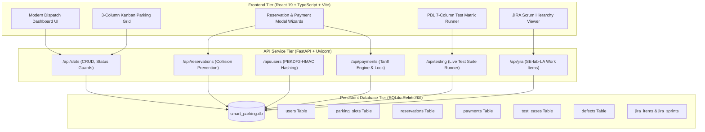
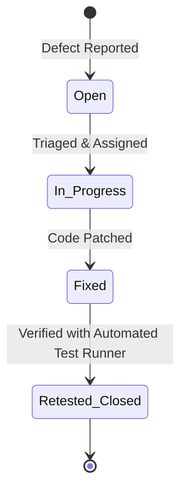

# Smart Parking Management System — PBL Submission Report

> **Project Title:** Smart Parking Management System  
> **Course / Context:** Project-Based Learning (PBL) Individual Evaluation — Software Engineering Lab  
> **JIRA Scrum Project Key:** `SE-lab-LA (SCRUM)`  
> **Repository Location:** `/Users/krish_01/.gemini/antigravity-ide/scratch/smart-parking-system`  
> **Application URLs:**
> - Frontend Web App: [http://localhost:5174](http://localhost:5174)
> - FastAPI Swagger API Docs: [http://127.0.0.1:8001/docs](http://127.0.0.1:8001/docs)

---

## 1. System Architecture & Component Design

The platform uses a Three-Tier Layered Client-Server Architecture designed to isolate the user interface, business logic, and persistent storage:



---

## 2. JIRA Project Mapping: `SE-lab-LA (SCRUM)`

The table below documents the alignment between the planned JIRA backlog and the implemented codebase:

| Epic Key | Epic Name | User Story / Task | Task Type | Implemented Feature / Endpoint | Status |
|---|---|---|---|---|---|
| **EPIC-1** | Parking Slot Management | View Available Parking Slots | Story (`SE-101`) | Filter slots by status (`Available`, `Occupied`, `Maintenance`) & vehicle type | **Verified** |
| **EPIC-1** | Parking Slot Management | Design Parking Slot Interface | Task (`SE-102`) | Modern card grid matching reference screenshot with colored pill badges | **Verified** |
| **EPIC-1** | Parking Slot Management | Add and Manage Parking Slots | Story (`SE-105`) | Modal dialog with inputs for Slot Number, Zone, Vehicle, Rate | **Verified** |
| **EPIC-1** | Parking Slot Management | Duplicate Slot Prevention | Task (`SE-107`) | Backend uniqueness check rejecting duplicates with `HTTP 400 Bad Request` | **Verified** |
| **EPIC-1** | Parking Slot Management | Status Transition Guards | Story (`SE-109`) | Prevents moving slot to `Maintenance` during active confirmed booking | **Verified** |
| **EPIC-2** | Parking Reservation Management | Book a Parking Slot | Story (`SE-201`) | Reservation booking form with duration calculation & slot locking | **Verified** |
| **EPIC-2** | Parking Reservation Management | Time Collision Prevention | Task (`SE-204`) | Overlap query rejecting two bookings occupying same slot at same time | **Verified** |
| **EPIC-2** | Parking Reservation Management | View Booking Details | Story (`SE-206`) | Generated Booking ID (`RES-XXXXX`) pass with customer & vehicle details | **Verified** |
| **EPIC-2** | Parking Reservation Management | Cancel Reservation | Story (`SE-207`) | Safe cancellation dialog automatically restoring slot availability | **Verified** |
| **EPIC-3** | User Management | Register New User | Story (`SE-301`) | Email format/uniqueness validation with PBKDF2 password hashing | **Verified** |
| **EPIC-3** | User Management | Log In to System | Story (`SE-306`) | Credential verification rejecting wrong passwords with `HTTP 401` | **Verified** |
| **EPIC-3** | User Management | Role-Based Access | Task (`SE-308`) | Distinct roles for `Administrator` and `Customer` | **Verified** |
| **EPIC-4** | Parking Payment Management | Calculate Parking Fees | Story (`SE-401`) | Dynamic tariff formula: `Duration (hours) × Rate + 5% service charge` | **Verified** |
| **EPIC-4** | Parking Payment Management | Make a Parking Payment | Story (`SE-405`) | Simulated Card, UPI, and NetBanking checkout with receipt printing | **Verified** |
| **EPIC-4** | Parking Payment Management | Integrate Razorpay Free API | Task (`SE-409`) | Razorpay order creation (paise), HMAC-SHA256 signature verification, and standard checkout popup | **Verified** |
| **EPIC-4** | Parking Payment Management | Duplicate Payment Lock | Task (`SE-407`) | Prevents re-submitting payments on already completed reservations | **Verified** |
| **EPIC-4** | Parking Payment Management | View Payment Status | Story (`SE-408`) | Audit ledger with filters for `Paid`, `Pending`, `Failed` transactions | **Verified** |

---

## 3. Database Schema

```sql
-- 1. User Accounts Table
CREATE TABLE users (
    id INTEGER PRIMARY KEY AUTOINCREMENT,
    name TEXT NOT NULL,
    email TEXT UNIQUE NOT NULL,
    phone TEXT NOT NULL,
    password_hash TEXT NOT NULL,
    role TEXT NOT NULL DEFAULT 'Customer', -- 'Administrator' | 'Customer'
    created_at TIMESTAMP DEFAULT CURRENT_TIMESTAMP
);

-- 2. Physical Parking Slots Table
CREATE TABLE parking_slots (
    id INTEGER PRIMARY KEY AUTOINCREMENT,
    slot_number TEXT UNIQUE NOT NULL,
    vehicle_type TEXT NOT NULL,           -- 'Car' | 'Bike'
    location_zone TEXT NOT NULL,          -- 'Zone A (North)', etc.
    hourly_rate REAL NOT NULL DEFAULT 5.0,
    status TEXT NOT NULL DEFAULT 'Available', -- 'Available' | 'Occupied' | 'Maintenance'
    current_vehicle TEXT,
    created_at TIMESTAMP DEFAULT CURRENT_TIMESTAMP,
    updated_at TIMESTAMP DEFAULT CURRENT_TIMESTAMP
);

-- 3. Vehicle Reservations Table
CREATE TABLE reservations (
    id INTEGER PRIMARY KEY AUTOINCREMENT,
    booking_id TEXT UNIQUE NOT NULL,       -- e.g. 'RES-71598'
    slot_id INTEGER NOT NULL,
    user_id INTEGER,
    customer_name TEXT NOT NULL,
    customer_email TEXT,
    customer_phone TEXT,
    vehicle_reg_number TEXT NOT NULL,
    vehicle_type TEXT NOT NULL,
    start_time TEXT NOT NULL,
    end_time TEXT NOT NULL,
    duration_hours REAL NOT NULL,
    total_amount REAL NOT NULL,
    status TEXT NOT NULL DEFAULT 'Confirmed', -- 'Confirmed' | 'Completed' | 'Cancelled'
    created_at TIMESTAMP DEFAULT CURRENT_TIMESTAMP,
    FOREIGN KEY (slot_id) REFERENCES parking_slots(id) ON DELETE RESTRICT,
    FOREIGN KEY (user_id) REFERENCES users(id) ON DELETE SET NULL
);

-- 4. Simulated Payments Table
CREATE TABLE payments (
    id INTEGER PRIMARY KEY AUTOINCREMENT,
    transaction_id TEXT UNIQUE NOT NULL,   -- e.g. 'TXN-88301'
    reservation_id INTEGER NOT NULL,
    amount REAL NOT NULL,
    hourly_rate REAL NOT NULL,
    duration_hours REAL NOT NULL,
    payment_method TEXT NOT NULL,
    status TEXT NOT NULL DEFAULT 'Paid',   -- 'Pending' | 'Paid' | 'Failed'
    notes TEXT,
    created_at TIMESTAMP DEFAULT CURRENT_TIMESTAMP,
    FOREIGN KEY (reservation_id) REFERENCES reservations(id) ON DELETE CASCADE
);

-- 5. Test Case Verification Register
CREATE TABLE test_cases (
    id INTEGER PRIMARY KEY AUTOINCREMENT,
    test_case_id TEXT UNIQUE NOT NULL,
    module TEXT NOT NULL,
    test_scenario TEXT NOT NULL,
    test_data TEXT NOT NULL,
    expected_result TEXT NOT NULL,
    actual_result TEXT NOT NULL,
    status TEXT NOT NULL DEFAULT 'Pending',
    test_type TEXT DEFAULT 'Functional',
    executed_at TEXT
);

-- 6. Defect Register
CREATE TABLE defects (
    id INTEGER PRIMARY KEY AUTOINCREMENT,
    bug_id TEXT UNIQUE NOT NULL,
    bug_description TEXT NOT NULL,
    steps_to_reproduce TEXT NOT NULL,
    severity TEXT NOT NULL,
    priority TEXT NOT NULL,
    status TEXT NOT NULL DEFAULT 'Open',
    resolution TEXT,
    related_module TEXT NOT NULL,
    retest_result TEXT,
    created_at TIMESTAMP DEFAULT CURRENT_TIMESTAMP
);
```

---

## 4. Formal PBL Test Case Matrix (7 Required Columns)

| Test Case ID | Module | Test Scenario | Test Data | Expected Result | Actual Result | Status |
|---|---|---|---|---|---|---|
| **TC-PS-001** | Parking Slot Management | Add new slot with unique slot number and zone | Slot: `E-999`, Type: `Car`, Zone: `Zone B`, Rate: `$5.5` | Slot created with status `Available` (HTTP 201) | Slot `E-999` created successfully in SQLite | **Pass** |
| **TC-PS-002** | Parking Slot Management | Reject duplicate slot number creation | Slot: `E-999` (Already exists) | HTTP 400 Bad Request with error detail | Returned HTTP 400: *"Slot number 'E-999' already exists"* | **Pass** |
| **TC-PS-003** | Parking Slot Management | Reject negative hourly rate or empty slot ID | Slot: `""`, Rate: `-$5.0` | Frontend and Backend validation rejection | Pydantic validation rejected request (`rate > 0`) | **Pass** |
| **TC-PS-004** | Parking Slot Management | Prevent slot Maintenance switch when active booking exists | Slot: `A-101` with active booking `RES-10492` | Rejects status change with conflict warning | HTTP 400 returned: *"Active booking exists on slot"* | **Pass** |
| **TC-PR-001** | Parking Reservation Management | Create reservation for available slot | Slot: `10`, Name: `PBL Evaluator`, Reg: `KA-01-MJ-9999` | Booking created, slot marked `Occupied` (HTTP 201) | Generated `RES-71598`, slot updated to `Occupied` | **Pass** |
| **TC-PR-002** | Parking Reservation Management | Prevent booking slot currently under Maintenance | Slot: `B-203` (Maintenance) | HTTP 400 Bad Request preventing reservation | HTTP 400 returned: *"Slot is currently Maintenance"* | **Pass** |
| **TC-PR-003** | Parking Reservation Management | Prevent two reservations from overlapping on same slot | Slot: `10`, overlapping time window | HTTP 400 Bad Request collision rejection | Overlap query detected collision; returned HTTP 400 | **Pass** |
| **TC-PR-004** | Parking Reservation Management | Cancel confirmed reservation and restore availability | Cancel booking `RES-71598` | Status updated to `Cancelled`, slot freed to `Available` | Slot `B-204` returned to `Available` | **Pass** |
| **TC-UM-001** | User Management | Register new customer account | Email: `new.user@example.com`, Phone: `+1 555-4321` | Account registered with PBKDF2 hashed password | User created; 64-character hash stored | **Pass** |
| **TC-UM-002** | User Management | Reject duplicate email address registration | Email: `admin@smartparking.edu` | HTTP 400 Bad Request: *"Email already registered"* | Duplicate email rejected | **Pass** |
| **TC-UM-003** | User Management | Authenticate with valid credentials | `admin@smartparking.edu` / `Admin@123` | HTTP 200 OK with session profile and role | Authenticated successfully as `Administrator` | **Pass** |
| **TC-UM-004** | User Management | Authenticate with invalid password | `admin@smartparking.edu` / `WrongPass999` | HTTP 401 Unauthorized rejection | HTTP 401 returned: *"Invalid email or password"* | **Pass** |
| **TC-PM-001** | Parking Payment Management | Calculate parking fee based on tariff and duration | Rate: `$5.00/hr`, Duration: `4.0 hrs` | Fee computed as `$20.00` + `$1.00` service charge | Accurate breakdown: `4.0 hrs @ $5 = $20 (+ $1 tax)` | **Pass** |
| **TC-PM-002** | Parking Payment Management | Process simulated payment transaction | Reservation: `RES-33412`, Method: `Simulated Card` | Transaction saved with status `Paid` & unique TXN ID | Generated `TXN-88301` and printed digital receipt | **Pass** |
| **TC-PM-003** | Parking Payment Management | Simulate payment failure for negative test handling | Failure toggle enabled in modal | Transaction recorded as `Failed` with error notice | Negative scenario verified with status `Failed` | **Pass** |
| **TC-PM-004** | Parking Payment Management | Prevent duplicate payment for paid reservation | Attempt payment on already Paid `RES-10492` | HTTP 400 Bad Request duplicate lock | HTTP 400: *"Duplicate payment prevented"* | **Pass** |
| **TC-PM-005** | Parking Payment Management | Process payment via Razorpay test API & verify HMAC | Key: `rzp_test_...`, Order: `order_...`, Pay: `pay_...` | Razorpay order generated in paise, HMAC signature verified | Order created, signature verified, payment saved | **Pass** |

---

## 5. Defect Register & Bug Tracking Lifecycle



### Sample Defect Record (from live database):
- **Bug ID:** `BUG-101`
- **Related Module:** `Parking Reservation Management`
- **Severity / Priority:** `Minor` / `Medium`
- **Description:** Timezone offset discrepancy on reservation end-time selector across midnight rollover.
- **Steps to Reproduce:**
  1. Open reservation modal.
  2. Select 23:00 start time and 3 hours duration.
  3. Observe end-time rollover across midnight.
- **Resolution:** Applied standardized ISO 8601 localized timestamp parser with cross-date boundary calculation in backend helper.
- **Retest Outcome:** Verified against test case `TC-PR-001`. Status updated to `Fixed` / `Retested/Closed`.

---

## 6. Evaluator Demonstration Sequence

1. **Verify Kanban Slot Dispatching & Duplicate Guard:**
   - Go to **Parking Slots** tab. Observe the 3-column kanban board (`Available`, `Occupied`, `Maintenance`).
   - Click `+ Add Parking Slot`, enter `A-101` (an existing slot), and click submit. Notice the prompt: *"Slot number 'A-101' already exists"*.
2. **Verify Collision Prevention:**
   - Click `Book Reservation` on any Available slot.
   - Enter Customer name `Professor Evaluation` and vehicle plate `KA-05-AB-1234`.
   - Submit and observe slot transition to `Occupied` and reservation status `Confirmed`.
   - Attempt to book the same slot for an overlapping time window. The engine will reject the collision with conflicting reservation details.
3. **Verify Tariff Calculation & Simulated Settlement:**
   - Go to **Payments** tab. Use the dynamic fee calculator to test custom hourly rates and durations.
   - In Reservations, click `Pay Fee` on a confirmed booking. Complete checkout.
   - Attempt to pay for the same reservation again. Notice the duplicate payment prevention trigger.
4. **Execute Automated Verification Suite:**
   - Go to **Testing & Test Cases** tab.
   - Click `Execute Live Test Runner`.
   - The backend runs live SQL queries and validation checks against all 16 test cases, updating statuses and execution timestamps in real time.
5. **Inspect JIRA Project Mapping:**
   - Go to **JIRA Project** tab to review the 4 Epics, 4 Sprints, and expandable Story/Task/Subtask hierarchy for `SE-lab-LA (SCRUM)`.
