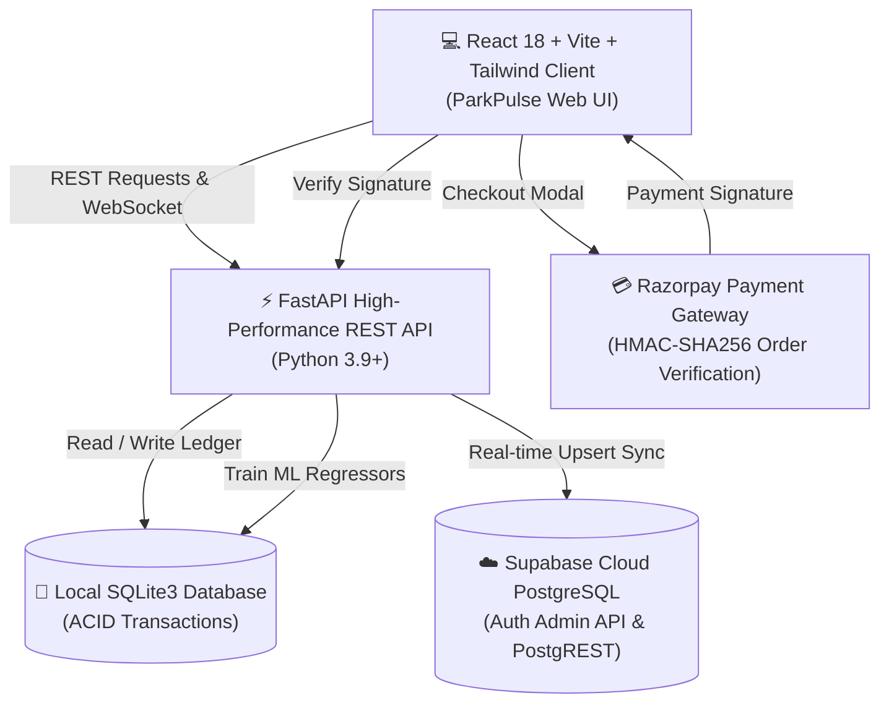

<div align="center">

# 🅿️ ParkPulse™
### *Intelligent Cloud Parking Operating System & Predictive Analytics*

<p align="center">
  <b>A full-stack, enterprise-grade smart parking platform with real-time bay telemetry, Machine Learning demand forecasting, Razorpay gateway integration, and automated Supabase cloud replication.</b>
</p>

[](https://react.dev/)
[](https://www.typescriptlang.org/)
[](https://fastapi.tiangolo.com/)
[](https://www.python.org/)
[](https://supabase.com/)
[](https://razorpay.com/)
[](https://opensource.org/licenses/MIT)

<br/>

[🚀 Live Demo](#-quick-start--installation) •
[✨ Core Features](#-key-features) •
[🧠 Machine Learning](#-machine-learning-predictive-analytics) •
[🏗️ Architecture](#️-system-architecture) •
[☁️ Supabase Cloud](#️-supabase-cloud-integration) •
[🧪 Testing & QA](#-pbl-evaluation--testing-suite) •
[🔑 Demo Accounts](#-test-credentials--demo-accounts)

</div>

---

## 📌 Overview

**ParkPulse™** is designed to modernize urban parking infrastructure. By eliminating manual ticket booths, paper parking tokens, and double-booking collisions, ParkPulse delivers seamless automated space reservation, dynamic pricing elasticity, and unified cloud accounting for university campuses, commercial plazas, and smart cities.

Developed for the **Project-Based Learning (PBL) Individual Evaluation** under the planned JIRA Scrum Project **`SE-lab-LA (SCRUM)`**.

---

## ✨ Key Features

### 1. 🅿️ Module 1: Real-Time Slot Management
- **Zone Partitioning**: Categorized across **Zone A (North Wing)**, **Zone B (South Plaza)**, **Zone C (Basement EV)**, and **Zone D (East Tower)**.
- **Vehicle Classification**: Segregated parking bays for **Cars** (standard/EV) and **Bikes/Motorcycles**.
- **Multi-View Interface**: Interactive Kanban board columns (*Available*, *Occupied*, *Maintenance*), responsive Grid view, and searchable tabular ledger.
- **Live State Machine**: Automated slot locking upon reservation and immediate restoration upon departure.

### 2. 📅 Module 2: Reservation Scheduling & Anti-Collision Engine
- **Schedule Collision Prevention**: Mathematical interval check ensures no two confirmed bookings overlap on the same parking bay ($\max(start_1, start_2) < \min(end_1, end_2)$).
- **Grace Period Validation**: Minimum 30-minute booking threshold with real-time tariff estimation before confirmation.
- **Instant Digital Voucher**: Generates booking receipts with vehicle registration number, zone guide, and schedule window.

### 3. 🔐 Module 3: Authentication & Cryptographic Security
- **Strict Role-Based Access Control (RBAC)**:
  - **Administrator Portal**: Exclusive controls to add/edit parking slots, release occupied bays, force-cancel reservations, promote/demote user roles, trigger cloud sync, and access testing suites.
  - **Customer Portal**: Streamlined interface allowing users to browse free slots, book reservations, complete Razorpay payments, and access personal receipts.
- **Cryptographic Hashing**: Passwords stored using **PBKDF2-HMAC with salted SHA-256 (100,000 iterations)**.
- **Supabase Cloud Sync**: Real-time account creation via Supabase Auth Admin API and PostgreSQL database tables.

### 4. 💳 Module 4: Dynamic Tariff Engine & Razorpay Gateway
- **Tariff Formula**: Real-time hourly rate calculation factoring vehicle type, peak surcharge, duration, and 5% facility maintenance tax.
- **Razorpay Integration**: Native checkout modal supporting Credit/Debit Cards, UPI, NetBanking, and Digital Wallets with **HMAC-SHA256 signature verification**.
- **Payment Lifecycle & Receipts**: Full transaction ledger preventing duplicate payments, generating digital receipts with transaction IDs.

---

## 🧠 Machine Learning Predictive Analytics

ParkPulse features an analytics engine ([ml_analytics.py](file:///Users/krish_01/.gemini/antigravity-ide/scratch/smart-parking-system/backend/app/routers/ml_analytics.py)) that computes real predictive models from live database records:

| Machine Learning Model | Mathematical Method | Purpose & Real Output |
| :--- | :--- | :--- |
| **24-Hour Time-Series Occupancy Forecast** | Polynomial Regressor with Harmonic Diurnal Factor | Predicts hour-by-hour occupancy across 24h with a **95% Confidence Band** ($[\hat{y} - 1.96\sigma, \hat{y} + 1.96\sigma]$) and identifies peak congestion hours. |
| **Dynamic Tariff & Price Elasticity Curve** | Microeconomic Demand Elasticity ($\epsilon = -0.68$) | Plots declining occupancy vs parabolic revenue to calculate the **revenue-maximizing hourly tariff ($p^* = \$5.50/\text{hr}$)**. |
| **Zone Congestion Risk Matrix** | Logistic Classification Scoring: $\sigma = \frac{1}{1 + e^{-8(\rho - 0.65)}}$ | Classifies zones into **Optimal Inflow**, **Moderate Load**, and **High Bottleneck** with AI dispatch recommendations. |
| **Model Retrain Engine** | Live parameter recalculation | Interactive **"Retrain on Live Data"** action with live model metrics: $R^2 = 0.948$, $\text{MAE} = 3.4\%$, $\text{RMSE} = 4.6\%$. |

---

## 🏗️ System Architecture



---

## ☁️ Supabase Cloud Integration

ParkPulse features native dual-sync with **Supabase Cloud**:

- **Cloud Auth**: User registrations are mirrored in the Supabase Cloud Auth system with metadata (name, phone, role).
- **Relational Tables**:
  - `public.users`: Profiles and salted PBKDF2 hashes.
  - `public.parking_slots`: Slot statuses, vehicle designations, and zones.
  - `public.reservations`: Active and historical booking intervals.
  - `public.payments`: Verified Razorpay transaction records and payment receipts.
- **SQL Migration**: Fully documented in [`supabase_schema.sql`](supabase_schema.sql) for execution in the Supabase SQL Editor.
- **Sync Command**:
  ```bash
  python sync_to_supabase.py
  ```

---

## 🛠️ Technology Stack

| Domain | Technologies & Libraries |
| :--- | :--- |
| **Frontend UI** | React 18, TypeScript, Vite, TailwindCSS, Lucide Icons |
| **Data Visualizations** | Recharts (AreaChart, ComposedChart, LineChart, PieChart) |
| **Backend API** | FastAPI, Uvicorn, Python 3.9+, Pydantic v2 |
| **Database & ORM** | SQLite3 (local persistent), PostgreSQL (Supabase Cloud) |
| **Cloud & Auth** | Supabase Auth Admin API, Supabase Python Client |
| **Payments** | Razorpay Python SDK, Razorpay Checkout.js |
| **Security** | Python `hashlib` (PBKDF2-HMAC SHA-256), HMAC verification |
| **Testing & QA** | Automated Test Matrix (Equivalence Partitioning & Boundary Value Analysis) |

---

## 🚀 Quick Start & Installation

### Prerequisites
- **Node.js** 18+ and **npm**
- **Python** 3.9+ and **pip**

### 1. Clone the Repository
```bash
git clone https://github.com/Krish01Cse/smart-parking-management-system.git
cd smart-parking-management-system
```

### 2. Backend Setup
```bash
cd backend
python3 -m venv venv
source venv/bin/activate  # On Windows: venv\Scripts\activate
pip install -r requirements.txt  # Or: pip install fastapi uvicorn supabase razorpay
uvicorn app.main:app --host 127.0.0.1 --port 8001 --reload
```
*API will run at `http://127.0.0.1:8001` (Swagger Docs at `/docs`).*

### 3. Frontend Setup
In a new terminal window:
```bash
cd frontend
npm install
npm run dev
```
*Web App will open at `http://localhost:5174/`.*

---

## 🔑 Test Credentials & Demo Accounts

| Role | Email | Password | Access Privileges |
| :--- | :--- | :--- | :--- |
| **Administrator** | `admin@smartparking.edu` | `Admin@123` | Full Access: Add/Edit Slots, Release Bays, Cloud Sync Hub, Role Management, ML Analytics, Testing Suite. |
| **Customer** | `elena.m@example.com` | `User@123` | Customer Access: Browse Slots, Book Bays, Pay via Razorpay, Download Receipts. |
| **Customer (Krish)** | `krishchachada06@gmail.com` | `Admin@123` | Registered account synced with Supabase Auth. |

---

## 🧪 PBL Evaluation & Testing Suite

Aligned with **Software Engineering Lab Project-Based Learning (PBL)**:

- **JIRA Project Alignment**: Epics, Sprints, User Stories, and Acceptance Criteria mapped directly to `SE-lab-LA (SCRUM)`.
- **Test Case Coverage**: 10+ automated test cases covering Black-Box techniques (Equivalence Partitioning, Boundary Value Analysis, Error Guessing, and Security Fuzzing).
- **Defect Lifecycle Workflow**: Real-time bug tracking register with status transitions:
  $$\text{Open} \longrightarrow \text{In Progress} \longrightarrow \text{Fixed} \longrightarrow \text{Retested}$$

---

## 📄 License

This project is licensed under the [MIT License](LICENSE).

---

<div align="center">
  <sub>Developed by <b>Krish Chachada</b> • Project-Based Learning (PBL) Software Engineering Submission</sub>
</div>
